# Diagrama de Componentes - Finca JIRAH

A continuación se presenta el diagrama de componentes super granular y detallado, cubriendo el 100% de la arquitectura del proyecto (Frontend, Backend, APIs, Patrones de Diseño, Repositorios y Base de Datos).

El diagrama está codificado en PlantUML. Puedes visualizarlo copiando el bloque en un renderizador como [PlantText](https://www.planttext.com/) o instalando la extensión de PlantUML en tu IDE.

```plantuml
@startuml Diagrama_de_Componentes_FincaJIRAH
!theme vibrant

skinparam componentStyle uml2
skinparam linetype ortho
skinparam packageStyle rectangle
skinparam roundcorner 10

title Diagrama de Componentes Detallado (100% Cobertura) - Finca JIRAH

package "1. Frontend Layer (React / Next.js - app/)" {
    package "Pages & Views" {
        [Dashboard Layout] as Dashboard
        [Login / Recuperar] as AuthPages
        [Módulo Personal] as PersonalView
        [Módulo Catálogos] as CatalogosView
        [Módulo Campo (Pesajes)] as CampoView
        [Módulo Perfil] as PerfilView
    }
    
    package "Custom Hooks (lib/hooks)" {
        [useSyncManager] as HookSyncManager
    }
    
    Dashboard --> AuthPages : "Redirect si no Auth"
    Dashboard *-- PersonalView
    Dashboard *-- CatalogosView
    Dashboard *-- CampoView
    Dashboard *-- PerfilView
    
    CampoView ..> HookSyncManager : "Observa estado de red"
}

package "2. API Gateway Layer (Next.js Route Handlers - app/api/)" {
    [API Auth] as ApiAuth
    [API Perfil] as ApiPerfil
    [API Dashboard] as ApiDashboard
    [API Agricultores] as ApiAgricultores
    [API Catálogos] as ApiCatalogos
    [API Campo] as ApiCampo
    [API Sync] as ApiSync
    
    AuthPages --> ApiAuth
    PerfilView --> ApiPerfil
    Dashboard --> ApiDashboard
    PersonalView --> ApiAgricultores
    CatalogosView --> ApiCatalogos
    CampoView --> ApiCampo
    HookSyncManager --> ApiSync : "Envía peticiones encoladas"
}

package "3. Backend Core Layer (Business Logic - lib/)" {
    
    package "Controllers (lib/controllers/)" {
        [AuthController] as CtrlAuth
        [PerfilController] as CtrlPerfil
        [AgricultorController] as CtrlAgricultor
        [CatalogoController] as CtrlCatalogo
        [PesajeController] as CtrlPesaje
        [AjusteController] as CtrlAjuste
        
        ApiAuth --> CtrlAuth
        ApiPerfil --> CtrlPerfil
        ApiAgricultores --> CtrlAgricultor
        ApiCatalogos --> CtrlCatalogo
        ApiCampo --> CtrlPesaje
        ApiCampo --> CtrlAjuste
        ApiSync --> CtrlPesaje : "Sincroniza pesajes diferidos"
    }
    
    package "Services (lib/services/)" {
        [auth.service] as SrvAuth
        [agricultor.service] as SrvAgricultor
        [catalogo.service] as SrvCatalogo
        [pesaje.service] as SrvPesaje
        [ajuste.service] as SrvAjuste
        [offline.service] as SrvOffline
        
        CtrlAuth --> SrvAuth
        CtrlAgricultor --> SrvAgricultor
        CtrlCatalogo --> SrvCatalogo
        CtrlPesaje --> SrvPesaje
        CtrlAjuste --> SrvAjuste
        HookSyncManager ..> SrvOffline : "Usa offline localmente"
    }

    package "Design Patterns (lib/)" {
        package "Strategy (lib/services/calculo/)" {
            [CalculadoraCosecha\n(Context)] as StrategyContext
            interface "ICalculoMargenError" as ICalculoMargen
            interface "ICalculoTara" as ICalculoTara
            [CalculoMargenPitahayaNormalStrategy] as StrategyMargenNormal
            [CalculoMargenPitahayaExportacionStrategy] as StrategyMargenExp
            [CalculoTaraGavetaStrategy] as StrategyTara
            
            StrategyContext *-- ICalculoMargen
            StrategyContext *-- ICalculoTara
            ICalculoMargen <|.. StrategyMargenNormal
            ICalculoMargen <|.. StrategyMargenExp
            ICalculoTara <|.. StrategyTara
            
            SrvPesaje --> StrategyContext : "Delega cálculo de taras y mermas"
        }
        
        package "Adapter (lib/adapters/)" {
            [OfflinePayloadAdapter] as AdapterOffline
            SrvOffline --> AdapterOffline : "Intercepta IndexedDB"
            AdapterOffline --> SrvPesaje : "Transforma a PrismaCreateInput"
        }
        
        package "State (lib/state/)" {
            [SyncStateContext] as StateContext
            interface "ISyncState" as ISyncState
            [PendingState] as StatePending
            [SyncingState] as StateSyncing
            [SyncedState] as StateSynced
            
            StateContext *-- ISyncState
            ISyncState <|.. StatePending
            ISyncState <|.. StateSyncing
            ISyncState <|.. StateSynced
            
            SrvOffline --> StateContext : "Gestiona ciclo de vida Offline-First"
            AdapterOffline --> StateContext : "Verifica estado inmutable"
        }
        
        package "Observer (lib/observers/)" {
            [NetworkSyncSubject] as ObserverSubject
            interface "ISyncObserver" as ISyncObserver
            
            HookSyncManager ..|> ISyncObserver : "Implementa e inyecta a React"
            ObserverSubject o-- ISyncObserver : "Mantiene Set<Subscribers>"
            SrvOffline --> ObserverSubject : "Publica eventos online/offline"
        }
    }
}

package "4. Data Access Layer (lib/repositories/)" {
    [UserRepository] as RepoUser
    [CampanaRepository] as RepoCampana
    [CatalogoRepository] as RepoCatalogo
    [DashboardRepository] as RepoDashboard
    [PesajeRepository] as RepoPesaje
    [AjusteRepository] as RepoAjuste
    
    SrvAuth --> RepoUser
    SrvAgricultor --> RepoUser
    SrvCatalogo --> RepoCampana
    SrvCatalogo --> RepoCatalogo
    SrvPesaje --> RepoPesaje
    SrvPesaje --> RepoCampana : "Valida existencia"
    SrvAjuste --> RepoAjuste
    ApiDashboard --> RepoDashboard : "Directo a Dashboard (Query Rápida)"
}

database "5. Base de Datos (Prisma ORM)" {
    folder "Models (prisma/schema.prisma)" {
        [User]
        [PasswordResetToken]
        [Campana]
        [Lote]
        [Comprador]
        [PesajeBruto]
        [Clasificacion]
        [AjusteComprador]
    }
    
    RepoUser --> [User]
    RepoUser --> [PasswordResetToken]
    RepoCampana --> [Campana]
    RepoCatalogo --> [Lote]
    RepoCatalogo --> [Comprador]
    RepoPesaje --> [PesajeBruto]
    RepoPesaje --> [Clasificacion]
    RepoAjuste --> [AjusteComprador]
    RepoDashboard --> [PesajeBruto] : "Agregaciones de suma"
    RepoDashboard --> [Clasificacion] : "Dashboard Metrics"
}

@enduml
```

### Explicación del Nivel de Granularidad
Este diagrama refleja exactamente el código actual y mapea tu arquitectura en 5 capas puras:
1. **Frontend Layer:** Detalla no solo las vistas del Next.js App Router, sino la inyección del hook reactivo (`useSyncManager`).
2. **API Gateway Layer:** Las APIs publicadas dentro de `app/api/` que funcionan como único punto de entrada HTTP desde el frontend al negocio.
3. **Backend Core Layer:** Mapea el enrutamiento desde los Controladores hacia los Servicios transaccionales y cómo el servicio central (`SrvPesaje` y `SrvOffline`) se apoya **totalmente** en las clases concretas de los 4 Patrones de Diseño (Estrategia, Adaptador, Estado, Observador).
4. **Data Access Layer:** Enlaza de manera 1 a 1 los Repositorios que centralizan el lenguaje SQL.
5. **Database Models:** Refleja la totalidad del `schema.prisma` actual con sus 8 modelos exactos y cómo interactúan con sus repositorios correspondientes.
